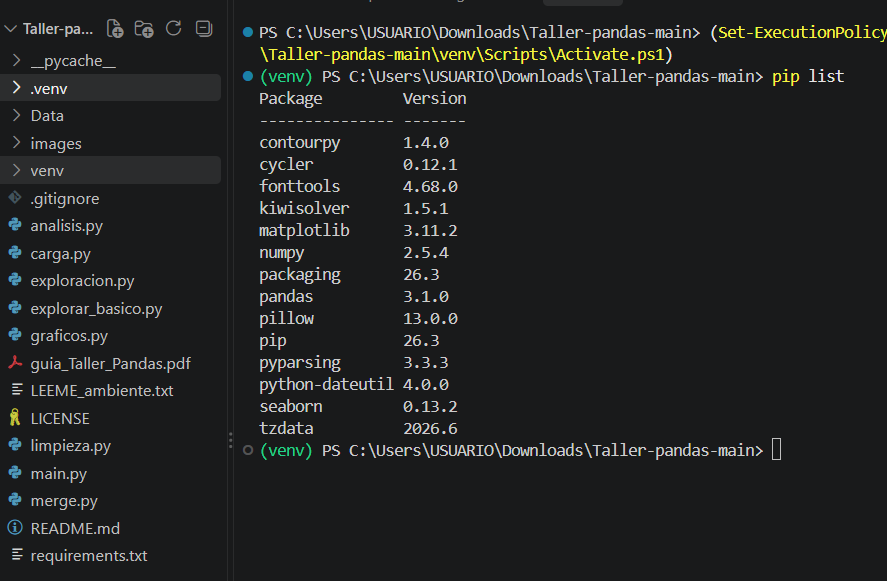
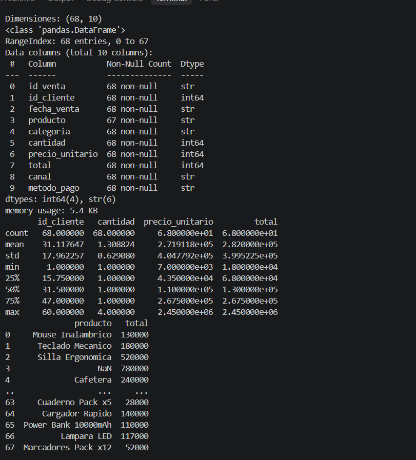
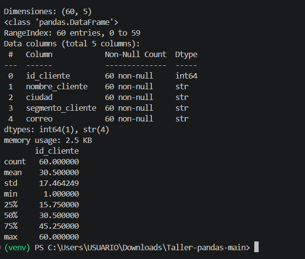
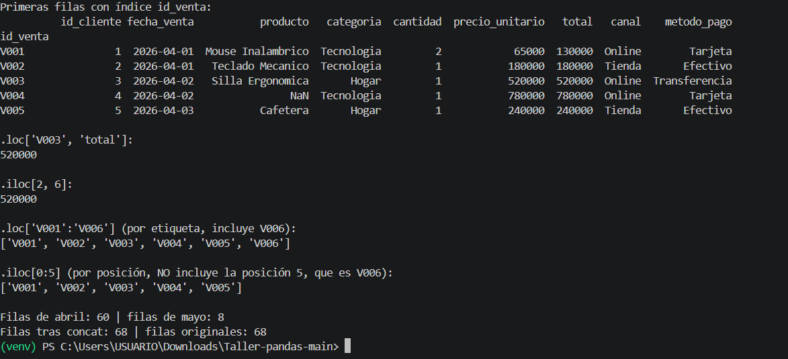
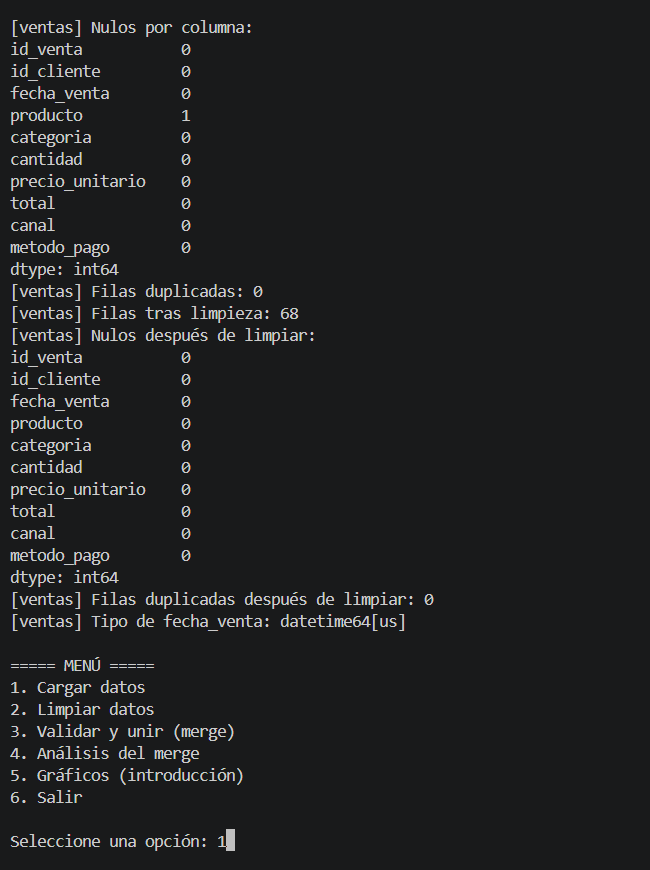
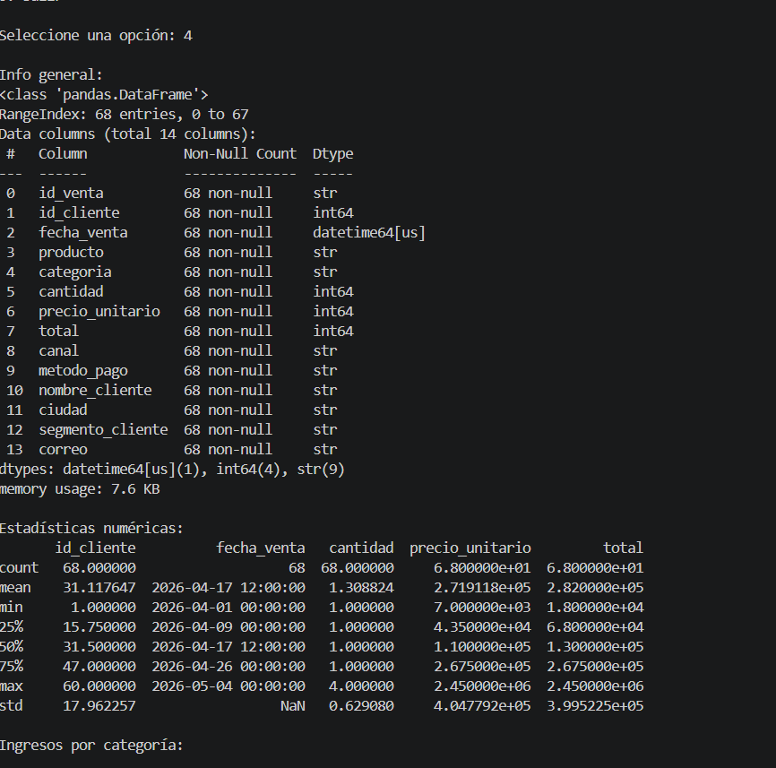

# Taller práctico: análisis de datos con Pandas

Programa de consola que lee datos de ventas y clientes, los limpia, los une y los analiza. Se ejecuta desde un menú en la terminal, y cada opción corresponde a un módulo que vas a completar paso a paso.

Recuerda consultar la guía adjunta en PDF donde se te dará el paso a paso del trabajo.

## Requisitos

- Python 3.10 o superior
- Git (para clonar el repositorio)
- Conocimientos básicos de variables, listas y funciones

## Cómo empezar

1. Clona el repositorio y entra a la carpeta del proyecto:

   ```
   git clone <URL-DEL-REPOSITORIO>
   cd <NOMBRE-DE-LA-CARPETA>
   ```

2. Crea y activa un ambiente virtual. Las instrucciones completas, para Windows y Mac/Linux, están en `LEEME_ambiente.txt`.

3. Instala las librerías:

   ```
   pip install -r requirements.txt
   ```

4. Ejecuta el programa:

   ```
   python main.py
   ```

Ejecuta siempre los comandos desde la carpeta del proyecto. Los módulos buscan los archivos a partir de su ubicación.

## Estructura del proyecto

```
├── main.py            Menú principal. No lo modifiques.
├── carga.py           Lee los CSV. Ya está completo.
├── limpieza.py        Limpia clientes y ventas. TODO 1 a 5.
├── merge.py           Valida y une las tablas. TODO 6 y 7.
├── analisis.py        Responde las preguntas de negocio. TODO 8 a 12.
├── graficos.py        Dibuja dos gráficos sencillos. TODO 13 y 14.
├── exploracion.py     Ejemplos de indexación, .loc, .iloc y concat. Se ejecuta por separado.
├── requirements.txt   Versiones de las librerías.
├── LEEME_ambiente.txt Pasos para crear el ambiente virtual.
└── Data/
    ├── raw/           Datos originales (cliente.csv, ventas.csv). No los modifiques.
    └── processed/     Resultados que genera el programa.
```

## Menú

| Opción | Qué hace |
|---|---|
| 1 | Carga los archivos CSV |
| 2 | Limpia los datos |
| 3 | Valida y une las tablas con merge |
| 4 | Muestra el análisis y las respuestas del desafío |
| 5 | Dibuja los gráficos de introducción |
| 6 | Sale del programa |

Las opciones se usan en orden: primero cargar (1), luego limpiar (2), después unir (3) y finalmente analizar (4) o graficar (5).

## Cómo completar el taller

1. Abre el archivo indicado en cada TODO. Cada función tiene un docstring con pistas.
2. Completa el TODO y ejecuta `python main.py` para probar la opción correspondiente.
3. Usa `exploracion.py` para practicar indexación, `.loc`, `.iloc` y `concat()` antes de aplicarlos en tu código.

Las funciones que aún no completaste no dan error: devuelven los datos sin cambios, así que el menú siempre funciona.

## Entregables

Consulta el documento del taller (`guia_Taller_Pandas.pdf`) para ver el detalle de cada entregable y la rúbrica. En resumen:

- Entregable 0: pantallazo del ambiente virtual activo y de la instalación.
- Entregable 1: pantallazos de `.shape`, `.info()` y `.describe()`, y salida de `exploracion.py`.
- Entregable 2: limpieza, con pantallazos antes y después y explicación.
- Entregable 3: validación, merge y análisis, con pantallazos de las opciones 3 y 4.
- Entregable 4: los dos gráficos (`.png`) y el código de `graficos.py`.
- Desafío final: respuestas a las cinco preguntas, con el criterio usado en cada una.

Para entregar, agrega al final de este `README.md` una sección con tu nombre y tus respuestas a las preguntas del desafío. Sube tus cambios al repositorio y envía el enlace por el formulario de entrega. La entrega es individual.

## Preguntas de negocio

1. ¿Qué categoría genera más ingresos?
2. ¿Qué canal vende más?
3. ¿Los clientes VIP compran más que los Regulares?
4. ¿Qué método de pago es el más usado?
5. ¿Cuáles son los cinco clientes con más compras?

## Entrega

**Nombre:** [TU NOMBRE AQUÍ]

### Desafío final

1. **¿Qué categoría genera más ingresos?**

   Resultado de la terminal:

   ```text
   Ingresos por categoría:
   Tecnologia    14290000
   Hogar          3653000
   Papeleria       749000
   Accesorios      484000
   Categoría con más ingresos: Tecnologia ($14,290,000)
   ```

   Tecnología es la categoría con más ingresos. Criterio: suma de `total` por categoría, ordenada de mayor a menor.

2. **¿Qué canal vende más?**

   Resultado de la terminal:

   ```text
           ventas  ingresos
   Online      35  14669000
   Tienda      33   4507000
   Canal que más vende (criterio: número de ventas): Online con 35 ventas.
   ```

   Online vende más por número de ventas; también gana por ingresos. Criterio: cantidad de ventas por canal.

3. **¿Los clientes VIP compran más que los Regulares?**

   Resultado de la terminal:

   ```text
                     clientes  compras  gasto_total  compras_por_cliente  gasto_por_cliente
   segmento_cliente
   Regular                 36       39     11110000             1.083333      308611.111111
   VIP                     24       29      8066000             1.208333      336083.333333
   VIP tiene más compras por cliente que Regular.
   VIP tiene más gasto por cliente que Regular.
   ```

   En promedio, los clientes VIP hacen más compras y gastan más por cliente. Criterio: compras y gasto divididos por los clientes únicos de cada segmento, no los totales.

4. **¿Qué método de pago es el más usado?**

   Resultado de la terminal:

   ```text
   Ventas por método de pago:
   Efectivo         30
   Tarjeta          25
   Transferencia    13
   Método más usado: Efectivo con 30 ventas.
   ```

   Efectivo es el método más usado. Criterio: conteo de ventas por método de pago.

5. **¿Cuáles son los cinco clientes con más compras?**

   Resultado de la terminal:

   ```text
                                compras  gasto_total
   id_cliente nombre_cliente
   21         Nicolas Cardona         2      2515000
   35         Matias Rodriguez        2      1278000
   52         Mia Quintero            2      1090000
   58         Luna Montoya            2      1007000
   3          Luis Perez              2       730000
   ```

   Estos son los cinco clientes con más compras; cada uno tiene dos. Criterio: número de compras y gasto total como desempate.

### Explicaciones

- **Uso de `fillna`:** rellené el producto vacío con `"Sin especificar"` para conservar la venta y su total. Con `dropna()` se habría eliminado toda esa fila.
- **Problemas en los datos:** encontré un nulo en `producto`. No había filas duplicadas ni textos inconsistentes; completé el producto vacío y convertí `fecha_venta` al tipo fecha.
- **Filas y columnas del merge:** tiene 68 filas porque `how="left"` conserva las 68 ventas. Tiene 14 columnas porque son las 10 columnas de ventas más las 5 de clientes, menos la columna compartida `id_cliente`.
- **Uso de `.iloc[2, 6]`:** después de `set_index("id_venta")`, `id_venta` deja de ser una columna. Contando desde cero, la posición 2 es la tercera fila (`V003`) y la posición 6 corresponde a `total`.

### Evidencias











Gráficos generados:

- [Ventas por categoría](Data/processed/graficos/ventas_por_categoria.png)
- [Ventas por canal](Data/processed/graficos/ventas_por_canal.png)
